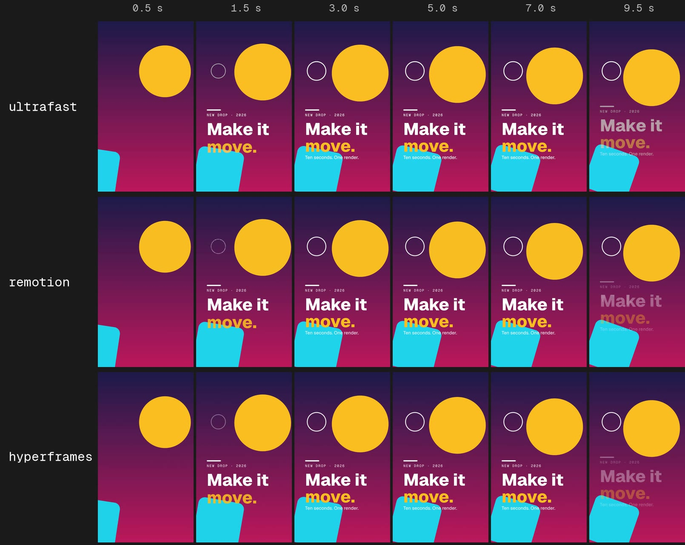
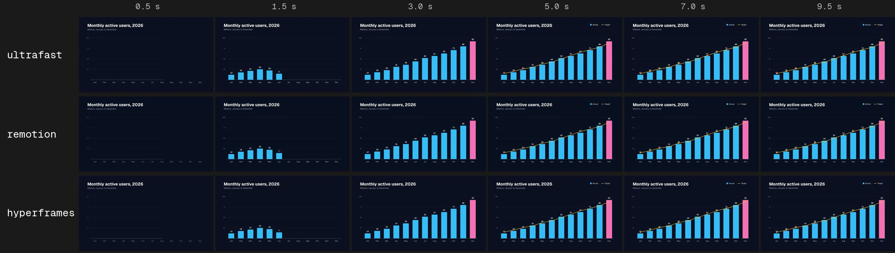
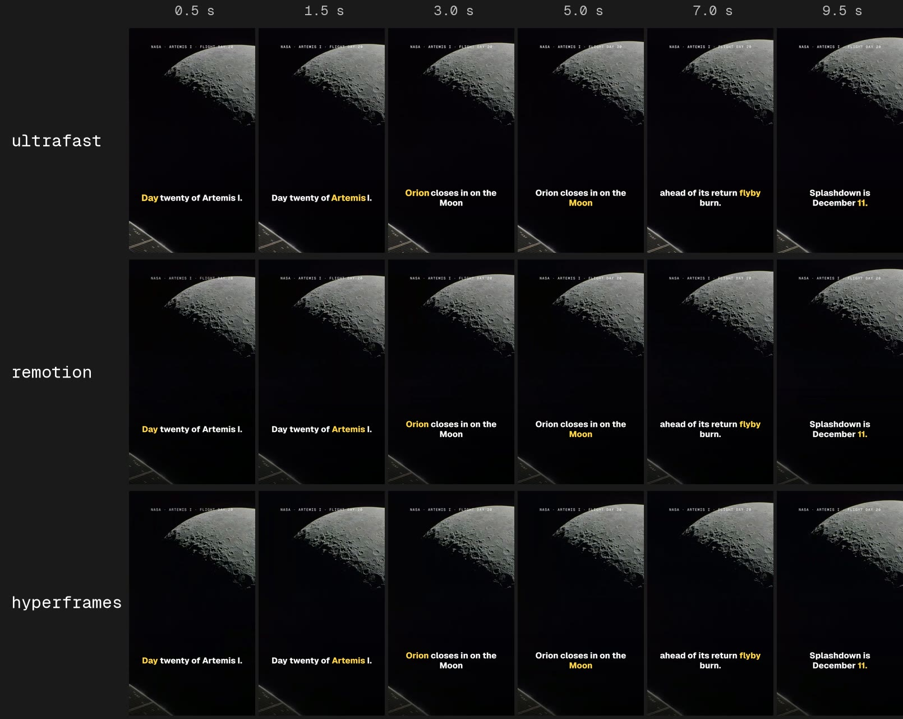
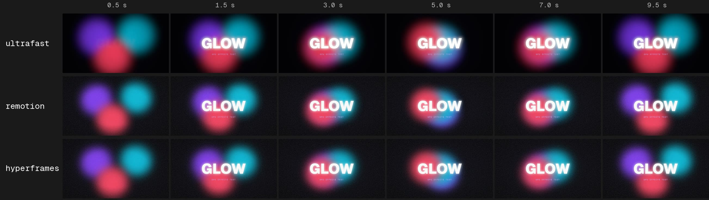

# ultrafast benchmarks: render speed and tokens, against Remotion and HyperFrames

How long does it take to export a finished 10-second video? Each tool runs its own render
command on the same workstation (AMD Ryzen 9 9950X3D2, 16 cores; NVIDIA RTX 5090), and
the clock runs from launch until the MP4 is on disk. Three short videos were written in
all three tools, plus a fourth (effects) reported separately.

**Warm median seconds, 300 frames each (lower is better).** In brackets: how many times
ultrafast's time each one is.

| Scene | ultrafast 0.1.1 | Remotion 4.0.545, default | Remotion, fastest found | HyperFrames 0.9.79, default | HyperFrames, fastest found |
|---|---:|---:|---:|---:|---:|
| title | **0.85** | 4.73 (5.6×) | 2.32 (2.7×) | 3.92 (4.6×) | 3.53 (4.1×) |
| chart | **0.88** | 4.45 (5.1×) | 2.25 (2.6×) | 3.71 (4.2×) | 3.31 (3.8×) |
| footage | **0.98** | 8.53 (8.7×) | 6.69 (6.8×) | 5.05 (5.1×) | 4.46 (4.5×) |
| *effects (not in the headline: favours a GPU engine)* | *0.97* | *5.95 (6.2×)* | *2.98 (3.1×)* | *6.42 (6.6×)* | *5.23 (5.4×)* |

"Fastest found" is the quickest of all the configurations measured for that tool on that
scene. That covers every concurrency, the GPU options, a prebuilt Remotion bundle, and
NVENC encoding. The fastest Remotion configuration used NVENC at its default quality in
three of the four scenes, which is a lower quality setting than the CRF 18 used everywhere
else (see the full tables).

ultrafast was faster in every scene and every configuration measured. That includes cold
first runs (2.5–2.6 s, against 8.4–12.6 s for Remotion and 3.7–6.4 s for HyperFrames) and
writing one still frame (0.34–0.82 s, against 2.2–2.4 s and 1.5–2.1 s). Where it did
worse: at the same nominal CRF 18 its NVENC files for the title, chart and footage scenes
are 2.0 to 4.4 times the size of the libx264 files from the two browser tools; it needs a
GPU; and it writes no colour tags into its H.264 (see the caveats).

Read the [caveats](#caveats-read-these-before-quoting-a-number) before quoting any of this.


## Tokens an agent writes

A second, separate measurement in [tokens/](tokens): the same 10-second 1080×1920 short (NASA footage, an
animated title, three lines of detail, word-timed captions, a grade and grain) written for ultrafast,
Remotion, HyperFrames and Shotstack the way each tool's own docs and agent skills teach, counted with
tiktoken `o200k_base`.

| | ultrafast | HyperFrames | Remotion | Shotstack |
|---|---:|---:|---:|---:|
| Files the agent writes, whole | **1,234** | 1,680 | 1,868 | 1,657 |
| Only what is typed after each tool's scaffold | **1,218** | 1,500 | 1,660 | 1,657 |

Method, per-file counts and what was excluded: [tokens/RESULTS.md](tokens/RESULTS.md). Reproduce with
`pip install tiktoken && python3 tokens/tokens.py`.


## What is measured

Four short videos, each written in all three tools the way each tool's docs teach.
[SPEC.md](SPEC.md) describes them, and [frames/](frames) shows all three outputs side by side:

| Scene | Size | What is in it |
|---|---|---|
| `title` | 1080×1920 | social title card: gradient, shapes, staggered type, fade and slide out |
| `chart` | 1920×1080 | 12 bars growing with counters and labels, a target line drawing on, legend |
| `footage` | 1080×1920 | a NASA clip (Orion approaching the Moon), push-in, shade, word-timed karaoke captions |
| `effects` | 1920×1080 | blurred colour fields, glowing title, a motion-blurred whip, grain, vignette (not in the headline) |

All four are 10 s at 30 fps, so every render is 300 frames, written to an H.264 MP4 at CRF 18
(`--crf 18` in all three tools). They all use the same font files and the same clip.

**The number is the wall-clock time of the tool's own render command**, from launch until the
MP4 is on disk. That covers everything a user waits for: process start, bundling (Remotion),
browser launch (Remotion, HyperFrames), GPU start-up and shader compilation (ultrafast),
rendering, encoding and muxing. Each run happens in its own cgroup
(`systemd-run --user --scope`), which also gives its CPU time and memory.

- **Warm**: the median of 5 runs after one warm-up run. This is the headline.
- **Cold**: the first run after deleting that tool's on-disk caches: compiled kernels
  (ultrafast), the webpack cache (Remotion), extracted video frames (HyperFrames). The
  operating system's file cache is not dropped (that needs root), and browsers stay
  downloaded, so "cold" means a first render after an edit or an install, not a cold boot.
- **Peak RAM**: the highest anonymous plus shared memory of all the processes the command
  started, sampled every 50 ms from the cgroup. File-backed memory (program code,
  libraries, page cache) is not counted, for any tool, which is why a single native
  process like ultrafast shows only about 100 MiB. GPU memory is reported separately
  (nvidia-smi, the rise during the run).
- **CPU**: CPU-seconds of the cgroup divided by wall time, as "threads busy on average".
  **GPU**: nvidia-smi utilisation sampled every 100 ms.
- **One still frame**: the time for each tool's CLI to write one PNG of frame 150
  (`ultrafast render --at 5`, `remotion still --frame=150`, `hyperframes snapshot --at 5`).
  This is the cheap stand-in for time to a first preview frame.

### Concurrency: each browser tool gets its default, its fastest and its maximum

Remotion and HyperFrames render frames in parallel browser tabs or processes, so the
concurrency setting matters. For every scene each was measured:

- with its **default command**: Remotion uses `min(8, threads / 2)` = 8 tabs here;
  HyperFrames picks `--workers auto`, which chose 6 workers on this machine;
- at the **fastest setting a sweep found** on this machine. Remotion's docs say to find it
  with `npx remotion benchmark`; HyperFrames' docs say to use `npx hyperframes benchmark`,
  and add that 4 workers is "usually the sweet spot". The sweep runs Remotion at
  2, 4, 8, 12, 16, 24 and 32 tabs and HyperFrames at 2, 4, 8, 12, 16 and 24 workers, twice each;
- at the **maximum**: `--concurrency 32` (every CPU thread, Remotion's limit) and
  `--workers 24` (HyperFrames' limit);
- in each tool's **best case** on top of that: Remotion rendering from a bundle made
  beforehand with `npx remotion bundle` (no webpack step in the timed command);
  HyperFrames with `--gpu` (NVENC encoding), alone and with the sweep's worker count.

The headline compares ultrafast with each browser tool's default command and with the
**fastest of all its configurations**, whichever that was.

Remotion's Chrome renders in software by default, so it was also given the GPU. Its docs give
`--gl=angle-egl` for that on Linux, which was measured at the sweep's concurrency, with and
without the prebuilt bundle. On this machine that path did not reach the RTX 5090 (see
caveat 6), but `--gl=vulkan` did, so Remotion also got a second sweep: `--gl=vulkan` from a
prebuilt bundle at 8, 12, 16, 24 and 32 tabs. Its fastest setting was measured in full, both
with libx264 at CRF 18 and with NVENC (`--hardware-acceleration if-possible`, which Remotion
only allows without `--crf`, so that run is at NVENC's default quality).

ultrafast was measured with its default command only. It renders on the GPU and hands frames
to the hardware encoder; its `export --workers N` option (render threads, one GPU queue
each) was left at its default, so if anything ultrafast's numbers here are not its best.

### Are the outputs right and the same?

Every output of every run is checked with ffprobe, and a run counts only if its output passes:
H.264, the right size, exactly 300 decoded frames, 10.0 s, 30 fps. The grids in `frames/`
show the same six moments from each tool's video, one row per tool, and there is a 10-frame
contact sheet per tool and scene. `results/similarity.json` scores each browser tool's
video against ultrafast's over all 300 frames (luma SSIM and PSNR, each file decoded with
its own colour matrix).

### A quiet machine

The desktop session stayed logged in, so the machine was not idle in the strict sense, and
another session was benchmarking on the same machine that night. Before every run the
harness waited until:

- no other renderer was working (Chrome headless, FFmpeg, ultrafast, a Remotion or
  HyperFrames CLI, Blender, Steam or Wine);
- other processes were using at most 1.5 of the 32 CPU threads, over 3 s;
- the GPU was under 15 % busy.

The busy threads, load average and top processes at the start of every run are in
`results.json`. If more than 1.5 threads of other CPU load, or another renderer, showed up
*during* a run, that run was discarded (kept in `results/runs.jsonl`, flagged) and repeated.

## Results

All numbers are from `results.json`. `results/tables.md` holds the same tables, regenerated
by `run.sh`. Every run counted here came after the machine was confirmed quiet; an earlier
attempt that overlapped another benchmark on the same machine was thrown away whole.

### All four scenes: warm median seconds (300 frames, 10 s video, H.264)

| Composition | ultrafast | Remotion default | Remotion fastest | HyperFrames default | HyperFrames fastest |
|---|---:|---:|---:|---:|---:|
| title | **0.85** | 4.73 (5.6×) | 2.32 (2.7×) | 3.92 (4.6×) | 3.53 (4.1×) |
| chart | **0.88** | 4.45 (5.1×) | 2.25 (2.6×) | 3.71 (4.2×) | 3.31 (3.8×) |
| footage | **0.98** | 8.53 (8.7×) | 6.69 (6.8×) | 5.05 (5.1×) | 4.46 (4.5×) |
| effects | **0.97** | 5.95 (6.2×) | 2.98 (3.1×) | 6.42 (6.6×) | 5.23 (5.4×) |

(×) = that time divided by ultrafast's: how many times longer the tool took.

Fastest configuration found for each browser tool:

- title: Remotion `prebuilt bundle, --gl=vulkan, NVENC (--hardware-acceleration, no CRF), --concurrency 24`, HyperFrames `--workers 8`
- chart: Remotion `prebuilt bundle, --gl=angle-egl, --concurrency 16`, HyperFrames `--workers 4`
- footage: Remotion `prebuilt bundle, --gl=vulkan, NVENC (--hardware-acceleration, no CRF), --concurrency 8`, HyperFrames `--workers 8`
- effects: Remotion `prebuilt bundle, --gl=vulkan, NVENC (--hardware-acceleration, no CRF), --concurrency 12`, HyperFrames `--workers 12`

### Cold first run (tool caches cleared), seconds

| Composition | ultrafast | Remotion | HyperFrames |
|---|---:|---:|---:|
| title | 2.49 | 8.46 | 3.93 |
| chart | 2.63 | 8.41 | 3.66 |
| footage | 2.62 | 12.56 | 5.55 |
| effects | 2.54 | 9.69 | 6.43 |

### Was the machine quiet?

- runs counted: 560; discarded because other work overlapped them: 0; failed: 0
- CPU busy just before a run (whole machine, threads of 32): median 0.19, max 1.45
- 1-minute load average at the start of a run: median 2.75, max 18.51 (includes the benchmark's own previous run)
- other processes' CPU during a run: median 0.19 threads, max 1.05

### Every measured configuration

| Composition | Tool | Configuration | Warm median s (min–max, n) | Cold s | CPU threads avg | Peak RAM MiB | GPU util % (mean) | GPU mem MiB | Output MB |
|---|---|---|---:|---:|---:|---:|---:|---:|---:|
| title | ultrafast | default command | 0.85 (0.84–0.86, 5) | 2.49 | 0.7 | 85 | 7 | 1091 | 2.7 |
| title | remotion | prebuilt bundle, --gl=vulkan, NVENC (--hardware-acceleration, no CRF), --concurrency 24 | 2.32 (2.31–2.60, 5) | – | 5.1 | 1668 | 8 | 1730 | 1.5 |
| title | remotion | prebuilt bundle, --gl=vulkan, --concurrency 24 | 2.42 (2.28–2.47, 5) | – | 8.2 | 3027 | 5 | 1087 | 0.7 |
| title | remotion | prebuilt bundle, --gl=angle-egl, --concurrency 12 | 2.63 (2.62–2.66, 5) | – | 6.5 | 2525 | 0 | 0 | 0.6 |
| title | remotion | prebuilt bundle, --concurrency 12 | 3.19 (3.18–3.22, 5) | – | 5.3 | 2668 | 0 | 0 | 0.6 |
| title | remotion | --gl=angle-egl --concurrency 12 | 4.04 (3.99–4.08, 5) | – | 4.8 | 3121 | 0 | 0 | 0.6 |
| title | remotion | --concurrency 12 | 4.54 (4.53–4.59, 5) | – | 4.2 | 3239 | 0 | 0 | 0.6 |
| title | remotion | --concurrency 32 (max) | 4.67 (4.67–4.72, 5) | – | 5.3 | 4849 | 0 | 0 | 0.6 |
| title | remotion | default command | 4.73 (4.65–4.78, 5) | 8.46 | 3.8 | 2911 | 0 | 0 | 0.6 |
| title | hyperframes | --workers 8 | 3.53 (3.50–3.57, 5) | – | 4.8 | 2548 | 6 | 776 | 1.1 |
| title | hyperframes | default command | 3.92 (3.91–3.96, 5) | 3.93 | 4.2 | 2268 | 4 | 582 | 1.1 |
| title | hyperframes | --gpu --workers 8 | 3.93 (3.82–3.96, 5) | – | 2.9 | 1532 | 6 | 1344 | 2.2 |
| title | hyperframes | --gpu (NVENC encode) | 4.33 (4.27–4.36, 5) | – | 2.6 | 1253 | 5 | 1150 | 2.2 |
| title | hyperframes | --workers 24 (max) | 4.40 (4.34–4.48, 5) | – | 6.0 | 4901 | 7 | 2318 | 1.1 |
| chart | ultrafast | default command | 0.88 (0.88–0.90, 5) | 2.63 | 0.8 | 124 | 10 | 1299 | 0.7 |
| chart | remotion | prebuilt bundle, --gl=angle-egl, --concurrency 16 | 2.25 (2.24–2.31, 5) | – | 6.1 | 2492 | 0 | 0 | 0.2 |
| chart | remotion | prebuilt bundle, --gl=vulkan, --concurrency 24 | 2.27 (2.24–2.32, 5) | – | 6.8 | 2811 | 5 | 1133 | 0.3 |
| chart | remotion | prebuilt bundle, --gl=vulkan, NVENC (--hardware-acceleration, no CRF), --concurrency 24 | 2.31 (2.30–2.47, 5) | – | 5.0 | 1698 | 7 | 1753 | 0.6 |
| chart | remotion | prebuilt bundle, --concurrency 16 | 2.90 (2.86–2.91, 5) | – | 4.8 | 2667 | 0 | 0 | 0.2 |
| chart | remotion | --gl=angle-egl --concurrency 16 | 3.65 (3.64–3.72, 5) | – | 4.3 | 3075 | 0 | 0 | 0.2 |
| chart | remotion | --concurrency 16 | 4.25 (4.22–4.34, 5) | – | 3.8 | 3232 | 0 | 0 | 0.2 |
| chart | remotion | --concurrency 32 (max) | 4.42 (4.32–4.46, 5) | – | 4.7 | 4441 | 0 | 0 | 0.2 |
| chart | remotion | default command | 4.45 (4.40–4.51, 5) | 8.41 | 3.1 | 2633 | 0 | 0 | 0.2 |
| chart | hyperframes | --workers 4 | 3.31 (3.29–3.34, 5) | – | 3.5 | 1976 | 2 | 421 | 0.3 |
| chart | hyperframes | default command | 3.71 (3.63–3.72, 5) | 3.66 | 3.7 | 2286 | 3 | 629 | 0.3 |
| chart | hyperframes | --gpu --workers 4 | 3.74 (3.70–3.77, 5) | – | 2.2 | 937 | 4 | 980 | 0.4 |
| chart | hyperframes | --gpu (NVENC encode) | 4.11 (4.08–4.17, 5) | – | 2.4 | 1233 | 4 | 1189 | 0.4 |
| chart | hyperframes | --workers 24 (max) | 4.17 (4.15–4.19, 5) | – | 6.1 | 4972 | 6 | 2479 | 0.3 |
| footage | ultrafast | default command | 0.98 (0.98–1.01, 5) | 2.62 | 0.8 | 129 | 8 | 1327 | 9.3 |
| footage | remotion | prebuilt bundle, --gl=vulkan, NVENC (--hardware-acceleration, no CRF), --concurrency 8 | 6.69 (6.58–6.83, 5) | – | 4.1 | 3962 | 5 | 1724 | 3.1 |
| footage | remotion | prebuilt bundle, --gl=vulkan, --concurrency 8 | 6.75 (6.65–6.84, 5) | – | 5.2 | 5095 | 9 | 1061 | 2.4 |
| footage | remotion | prebuilt bundle, --gl=angle-egl, --concurrency 8 | 6.75 (6.69–6.81, 5) | – | 5.2 | 5016 | 0 | 0 | 2.4 |
| footage | remotion | prebuilt bundle, --concurrency 8 | 7.22 (7.12–7.42, 5) | – | 5.7 | 5698 | 0 | 0 | 2.5 |
| footage | remotion | --gl=angle-egl --concurrency 8 | 8.15 (8.00–8.34, 5) | – | 4.6 | 5747 | 0 | 0 | 2.4 |
| footage | remotion | default command | 8.53 (8.32–8.59, 5) | 12.56 | 5.1 | 6212 | 0 | 0 | 2.5 |
| footage | remotion | --concurrency 8 | 8.63 (8.57–8.68, 5) | – | 5.1 | 6474 | 0 | 0 | 2.5 |
| footage | remotion | --concurrency 32 (max) | 21.66 (21.30–21.98, 5) | – | 7.6 | 17853 | 0 | 0 | 2.5 |
| footage | hyperframes | --workers 8 | 4.46 (4.42–4.49, 5) | – | 5.5 | 2789 | 5 | 2213 | 4.7 |
| footage | hyperframes | --gpu --workers 8 | 4.81 (4.71–4.83, 5) | – | 3.1 | 1773 | 6 | 2788 | 10.9 |
| footage | hyperframes | default command | 5.05 (5.03–5.10, 5) | 5.55 | 4.5 | 2464 | 4 | 2053 | 4.7 |
| footage | hyperframes | --workers 24 (max) | 5.19 (5.17–5.36, 5) | – | 6.9 | 5264 | 7 | 3615 | 4.7 |
| footage | hyperframes | --gpu (NVENC encode) | 5.39 (5.38–5.43, 5) | – | 2.6 | 1468 | 5 | 2608 | 10.9 |
| effects | ultrafast | default command | 0.97 (0.96–0.97, 5) | 2.54 | 0.7 | 121 | 16 | 1289 | 9.0 |
| effects | remotion | prebuilt bundle, --gl=vulkan, NVENC (--hardware-acceleration, no CRF), --concurrency 12 | 2.98 (2.95–2.98, 5) | – | 3.1 | 1059 | 15 | 1347 | 2.7 |
| effects | remotion | prebuilt bundle, --gl=vulkan, --concurrency 12 | 3.20 (3.18–3.21, 5) | – | 13.6 | 2180 | 12 | 728 | 16.0 |
| effects | remotion | prebuilt bundle, --gl=angle-egl, --concurrency 12 | 4.13 (4.09–4.15, 5) | – | 20.2 | 3390 | 0 | 0 | 16.2 |
| effects | remotion | prebuilt bundle, --concurrency 12 | 4.51 (4.49–4.54, 5) | – | 17.4 | 3601 | 0 | 0 | 16.2 |
| effects | remotion | --gl=angle-egl --concurrency 12 | 5.48 (5.46–5.50, 5) | – | 15.6 | 3978 | 0 | 0 | 16.2 |
| effects | remotion | --concurrency 12 | 5.86 (5.84–5.88, 5) | – | 13.8 | 4137 | 0 | 0 | 16.2 |
| effects | remotion | default command | 5.95 (5.82–6.04, 5) | 9.69 | 12.6 | 3471 | 0 | 0 | 16.2 |
| effects | remotion | --concurrency 32 (max) | 6.42 (6.35–6.49, 5) | – | 15.5 | 7398 | 0 | 0 | 16.2 |
| effects | hyperframes | --workers 12 | 5.23 (5.21–5.25, 5) | – | 10.5 | 3175 | 31 | 4555 | 18.1 |
| effects | hyperframes | --gpu --workers 12 | 5.30 (5.25–5.32, 5) | – | 4.5 | 2450 | 30 | 5121 | 17.2 |
| effects | hyperframes | default command | 6.42 (6.38–6.44, 5) | 6.43 | 7.0 | 2281 | 21 | 2325 | 18.0 |
| effects | hyperframes | --gpu (NVENC encode) | 6.56 (6.55–6.63, 5) | – | 2.7 | 1386 | 22 | 2886 | 17.2 |
| effects | hyperframes | --workers 24 (max) | 7.87 (7.84–7.89, 5) | – | 8.0 | 4752 | 22 | 8128 | 18.1 |

### Concurrency sweep (median of 2 warm runs, seconds)

- title, remotion: 2 → 9.19, 4 → 6.13, 8 → 4.60, 12 → 4.50, 16 → 4.52, 24 → 4.57, 32 → 4.67
- title, remotion, prebuilt bundle + `--gl=vulkan`: 8 → 3.51, 12 → 2.77, 16 → 2.40, 24 → 2.29, 32 → 2.41
- title, hyperframes: 2 → 4.41, 4 → 3.69, 8 → 3.50, 12 → 3.73, 16 → 3.98, 24 → 4.38
- chart, remotion: 2 → 9.01, 4 → 5.77, 8 → 4.42, 12 → 4.19, 16 → 4.18, 24 → 4.19, 32 → 4.34
- chart, remotion, prebuilt bundle + `--gl=vulkan`: 8 → 2.82, 12 → 2.72, 16 → 2.37, 24 → 2.28, 32 → 2.32
- chart, hyperframes: 2 → 3.55, 4 → 3.26, 8 → 3.31, 12 → 3.49, 16 → 3.69, 24 → 4.21
- footage, remotion: 2 → 12.55, 4 → 8.45, 8 → 8.32, 12 → 10.01, 16 → 11.80, 24 → 16.41, 32 → 21.51
- footage, remotion, prebuilt bundle + `--gl=vulkan`: 8 → 6.71, 12 → 8.36, 16 → 10.03, 24 → 13.72, 32 → 16.82
- footage, hyperframes: 2 → 6.31, 4 → 4.92, 8 → 4.46, 12 → 4.49, 16 → 4.72, 24 → 5.21
- effects, remotion: 2 → 12.06, 4 → 7.67, 8 → 5.91, 12 → 5.86, 16 → 5.95, 24 → 6.15, 32 → 6.43
- effects, remotion, prebuilt bundle + `--gl=vulkan`: 8 → 3.83, 12 → 3.17, 16 → 3.21, 24 → 3.28, 32 → 3.39
- effects, hyperframes: 2 → 11.75, 4 → 7.38, 8 → 5.35, 12 → 5.19, 16 → 5.59, 24 → 7.92

### One still frame (t = 5 s) from the CLI, warm median seconds

| Composition | ultrafast `render --at 5` | Remotion `still --frame=150` | HyperFrames `snapshot --at 5` |
|---|---:|---:|---:|
| title | 0.34 | 2.19 | 1.52 |
| chart | 0.35 | 2.16 | 1.52 |
| footage | 0.82 | 2.29 | 2.10 |
| effects | 0.59 | 2.35 | 1.96 |

### Same picture? Luma SSIM / PSNR against ultrafast's video, all 300 frames

| Composition | Output compared with ultrafast's | SSIM | PSNR dB |
|---|---|---:|---:|
| title | remotion default | 0.989 | 29.9 |
| title | hyperframes default | 0.985 | 29.0 |
| title | remotion fastest (bundled-vulkan-nvenc-c24) | 0.989 | 30.0 |
| title | hyperframes fastest (w8) | 0.985 | 29.0 |
| chart | remotion default | 0.993 | 34.6 |
| chart | hyperframes default | 0.991 | 34.0 |
| chart | remotion fastest (bundled-angle-egl-c16) | 0.993 | 34.6 |
| chart | hyperframes fastest (w4) | 0.991 | 34.0 |
| footage | remotion default | 0.949 | 27.5 |
| footage | hyperframes default | 0.936 | 25.8 |
| footage | remotion fastest (bundled-vulkan-nvenc-c8) | 0.949 | 27.6 |
| footage | hyperframes fastest (w8) | 0.936 | 25.8 |
| effects | remotion default | 0.625 | 25.2 |
| effects | hyperframes default | 0.626 | 25.5 |
| effects | remotion fastest (bundled-vulkan-nvenc-c12) | 0.640 | 25.4 |
| effects | hyperframes fastest (w12) | 0.626 | 25.5 |

The frame grids are in [frames/](frames): `title.jpg`, `chart.jpg`, `footage.jpg` and
`effects.jpg` put the same six moments from each tool's video side by side, and
`<scene>-<tool>-sheet.jpg` is a 10-frame contact sheet of each output. The low SSIM on
`effects` is expected: the grain is random noise in all three, drawn differently, and the
blurs are computed differently (SPEC.md).







## Hardware and software

| | |
|---|---|
| CPU | AMD Ryzen 9 9950X3D2 16-Core Processor, 16 cores / 32 threads, up to 5.76 GHz |
| RAM | 60.4 GiB |
| GPU | NVIDIA GeForce RTX 5090, 32 GB, driver 620.70.06 (also an AMD Radeon 610M integrated GPU, unused except as noted in caveat 6) |
| OS | Fedora Linux 45, Linux 7.3.3-300.fc45.x86_64, KDE Plasma session logged in |
| Node / npm | v22.23.1 / 10.9.8 |
| ultrafast | 0.1.1 release binary (sha256 `409b020e9a6e85e4…`), Vulkan backend on the RTX 5090 |
| Remotion | remotion, @remotion/cli, @remotion/media 4.0.545; React 19.3.1; its chrome-headless-shell 158.0.8127.2; its bundled FFmpeg (libx264) |
| HyperFrames | hyperframes 0.9.79; GSAP 3.15.0; its chrome-headless-shell 158.0.8127.36; FFmpeg n9.0.2 static (BtbN, GPL, libx264) |
| FFmpeg on PATH | ffmpeg version 9.0.2 (Fedora ffmpeg-free; ultrafast uses it only to mux) |

All of this is recorded by `harness/env_info.py` in `results/environment.json` and `results.json`.

## The commands

Exactly what was timed. Each runs from the folder shown, with the environment in
[harness/env.sh](harness/env.sh) (caches kept inside this folder, telemetry and update
checks off).

```sh
# ultrafast (in ultrafast/)
ultrafast export title.json out.mp4 --crf 18

# Remotion (in remotion/)
npx remotion render src/index.ts title out.mp4 --crf 18                     # default
npx remotion render src/index.ts title out.mp4 --crf 18 --concurrency 16    # sweep / max
npx remotion bundle src/index.ts --out-dir build                            # once, then:
npx remotion render build title out.mp4 --crf 18 --concurrency 16          # prebuilt bundle
npx remotion render src/index.ts title out.mp4 --crf 18 --concurrency 12 --gl=angle-egl  # GPU in Chrome
npx remotion render build title out.mp4 --crf 18 --concurrency 24 --gl=vulkan             # GPU via Vulkan
npx remotion render build title out.mp4 --concurrency 24 --gl=vulkan --hardware-acceleration if-possible  # + NVENC

# HyperFrames (in hyperframes/title/)
npx hyperframes render -o out.mp4 --crf 18                  # default (--workers auto)
npx hyperframes render -o out.mp4 --crf 18 --workers 8      # sweep / max
npx hyperframes render -o out.mp4 --crf 18 --gpu            # NVENC encoding

# one still frame
ultrafast render title.json --at 5 --out f.png
npx remotion still src/index.ts title f.png --frame=150
npx hyperframes snapshot --at 5 --no-end -o dir
```

The exact command line of every run is in `results.json` (`runs[].argv`).

## Caveats: read these before quoting a number

1. **It is a GPU engine against browser engines, on a machine with a big GPU.** ultrafast
   renders every frame on the RTX 5090 (Vulkan) and encodes with NVENC, the card's hardware
   encoder. Remotion renders in headless Chrome, which uses software rendering (SwiftShader)
   by default, and encodes with libx264 on the CPU. HyperFrames renders in headless Chrome
   with the GPU on (it detected the RTX 5090 by itself) and encodes with libx264 by default.
   On a machine without a capable GPU the comparison is different: ultrafast needs a
   Vulkan or Metal GPU, and the browser tools do not.
2. **Encoders differ, so "CRF 18" is not the same quality in all three.** ultrafast's
   `--crf 18` sets NVENC's constant-quality mode, and the browser tools pass CRF 18 to
   libx264 (preset medium). NVENC files at the same number are larger here: 2.7 MB
   against 0.6 MB (Remotion) and 1.1 MB (HyperFrames) for the title card, 2.0 to 4.4
   times the size across the first three scenes. On `effects` they are about half the
   size, because the browser tools' grain is costlier to compress. The tables give
   every file size. Swapping in NVENC shows how little of the gap the encoder accounts
   for. HyperFrames with `--gpu` was 0.1 to 0.4 s slower than with libx264 at the same
   worker count. Remotion with NVENC ranged from 0.22 s faster to 0.04 s slower than with
   libx264, and it ran at NVENC's default quality, since Remotion does not allow `--crf`
   with it: its `effects` file is 2.7 MB against 16 MB.
3. **Most of ultrafast's time is start-up.** Of about 0.9 s per render, ultrafast's own log
   gives 0.30 to 0.42 s for rendering and encoding the 300 frames. The rest is process
   and GPU start-up and muxing. For short videos the end-to-end ratio is therefore smaller
   than the rendering-speed ratio, and the end-to-end one is the honest number to quote.
   Longer videos should widen the gap, because every tool's fixed costs then matter less,
   but only 10 s videos were measured here.
4. **The effects scene favours a GPU engine and is not in the headline.** Blur, glow, motion
   blur and grain are exactly what a GPU compositor does cheaply and Chrome does slowly. The
   looks are also only close, not identical (see SPEC.md and `frames/effects.jpg`). It
   is reported so you can see the size of that effect, not as a like-for-like result.
5. **FFmpeg setup for HyperFrames.** Fedora's packaged FFmpeg (`ffmpeg-free`) has no libx264.
   With it, HyperFrames quietly falls back to NVENC. HyperFrames' docs assume a normal
   FFmpeg (apt or brew, which include libx264), so the benchmark points it at a static
   FFmpeg 9.0.2 build with libx264 (`setup.sh`, `HYPERFRAMES_FFMPEG_PATH`). The NVENC path
   was measured too (`--gpu`).
6. **Remotion and the GPU on this machine.** The machine has the RTX 5090 and an AMD
   Radeon 610M integrated GPU. Remotion's docs give `--gl=angle-egl` for using the GPU on
   Linux. Here that path rendered on the integrated Radeon: up to 100 % busy in sysfs, and
   no NVIDIA memory or utilisation in any run. It still made Remotion faster. `--gl=vulkan`
   used the RTX 5090 (checked in nvidia-smi), so it was swept and measured as well.
   Pointing EGL at NVIDIA's driver (`__EGL_VENDOR_LIBRARY_FILENAMES`) made `angle-egl` use
   the RTX 5090, but it was no faster (one spot check on `effects`). The headline uses
   whichever was fastest for each scene.
7. **Video decoding differs.** ultrafast decodes the clip on the GPU. Remotion's
   `<Video>` from `@remotion/media` decodes in every browser tab, so with many tabs Remotion
   gets slower on the footage scene (8.6 s at 8 tabs, 21.7 s at 32). HyperFrames extracts
   the frames with FFmpeg once and caches them, so its warm runs reuse them; its cold run
   includes the extraction.
8. **"Cold" is not a cold boot.** Cold runs clear each tool's own caches but not the
   operating system's file cache, and the browsers stay installed. ultrafast's cold run
   compiles its GPU pipelines (53 to 55 of them, which adds about 1.6 to 1.8 s),
   Remotion's runs webpack without its cache, and HyperFrames' extracts the video frames
   again.
9. **Colour tags.** ultrafast 0.1.1 writes BT.709 video without colour tags in the file.
   Remotion writes BT.601 without tags. HyperFrames tags its files as BT.709. Players that
   guess BT.601 for untagged HD video (FFmpeg-based tools) show ultrafast's colours
   slightly off, and players that guess BT.709 (most browsers) show Remotion's slightly
   off. This does not affect speed; the comparison grids decode each file with the matrix
   it was actually written with.
10. **One machine, one night.** Every number here comes from one AMD Ryzen 9 9950X3D2 and
    RTX 5090 workstation. Another session was running a similar benchmark on the machine
    earlier that night: every run made before it stopped was thrown away, and the whole
    benchmark was run again from scratch afterwards (see "A quiet machine").
11. **Idiomatic, not hand-tuned.** Each scene is written the way the tool's docs teach,
    with no tool-specific speed tricks beyond the documented options measured above.
    Someone who knows a tool well could probably make its version faster, and the source
    for all three is here to try.


## Reproduce it

You need Linux with cgroup v2 and systemd (for `systemd-run --user --scope`), an NVIDIA
GPU with `nvidia-smi`, Node 22 or newer, Python 3, FFmpeg and ffprobe on PATH (ultrafast
muxes with it), and the ultrafast 0.1.1 release
(<https://github.com/ultrafastmov/ultrafast/releases>).

```sh
./setup.sh                          # installs the pinned npm packages and browsers in this folder
UF=/path/to/ultrafast ./run.sh --fresh
```

`setup.sh` installs exactly the versions in the two `package-lock.json` files, the
chrome-headless-shell builds those versions pin, and a static FFmpeg 9.0.2 with libx264 for
HyperFrames (see the caveats), all inside this folder. `run.sh` writes `results/runs.jsonl`
(one line per run), `results.json`, `results/tables.md`, `results/similarity.json` and
`frames/`. With the waits for a quiet machine, a full run takes one to two hours. Nothing
in it is random: the scenes are pure functions of time, and the runs go in a fixed order.

## Files

| Path | What |
|---|---|
| [SPEC.md](SPEC.md) | the four scenes, as all three tools implement them |
| [ultrafast/build.py](ultrafast/build.py) | writes the ultrafast documents (`*.json`) |
| [remotion/src](remotion/src) | the Remotion project |
| [hyperframes/](hyperframes) | one HyperFrames project per scene |
| [harness/](harness) | `bench.py` (runs and measures), `runner.py` (inside the cgroup), `verify.py` (grids and similarity), `summarize.py`, `env_info.py`, `env.sh` |
| [results.json](results.json) | every run and every summary number |
| [results/](results) | `runs.jsonl`, `tables.md`, `environment.json`, `similarity.json` |
| [frames/](frames) | the side-by-side grids and per-tool contact sheets |
| [assets/](assets) | fonts (SIL OFL) and the NASA clip ([provenance](assets/footage/PROVENANCE.md)) |

## Licences

The scripts and compositions in this repository are under Apache-2.0 or MIT, at your option (`LICENSE-APACHE`, `LICENSE-MIT`). Geist and Geist Mono are
under the SIL Open Font License
(`assets/fonts/licenses`). The clip is NASA footage, not subject to copyright in the
United States ([provenance](assets/footage/PROVENANCE.md)). The grain in the HyperFrames
`effects` scene is the `grain-overlay` block from the HyperFrames registry (Apache-2.0).
GSAP, Remotion and HyperFrames are installed from npm by `setup.sh` under their own
licences and are not part of this repository. Remotion is source-available: free for
individuals and organisations of up to three people, while larger companies need a company
licence.
